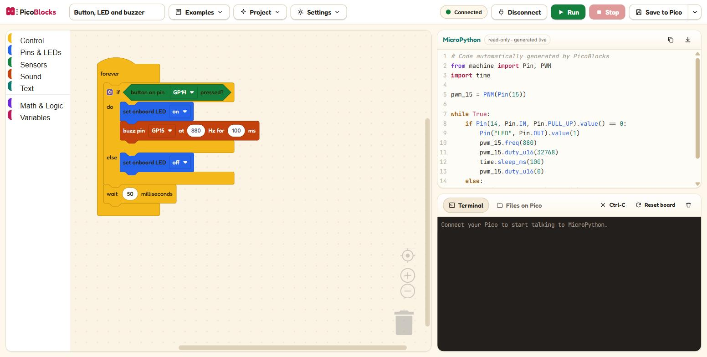
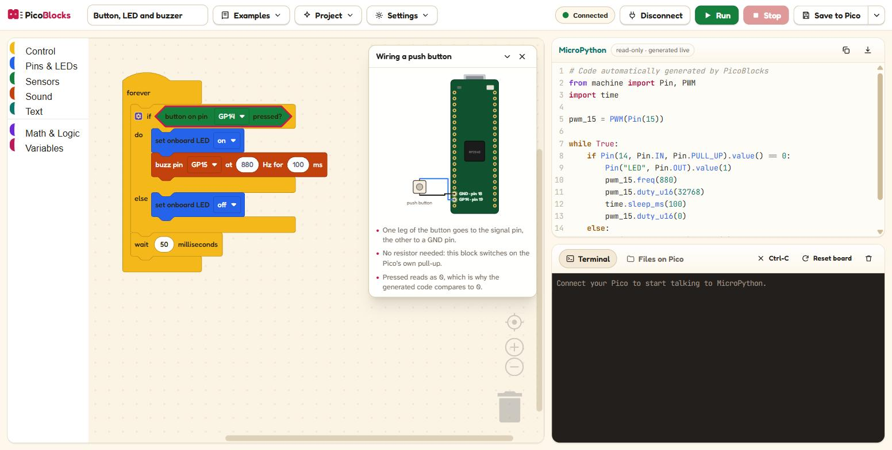
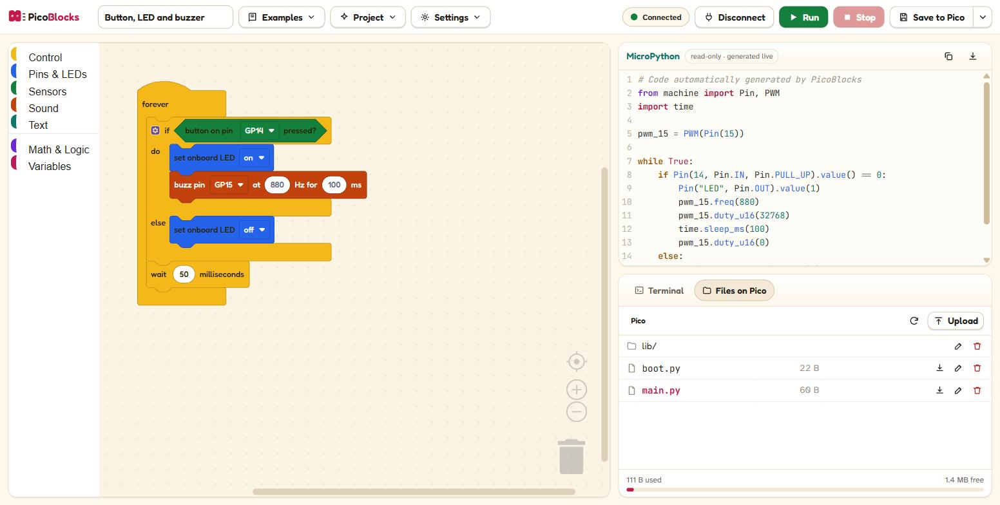

# PicoBlocks

Drag blocks, watch the MicroPython appear, and run it on a Raspberry Pi Pico —
from a browser tab. No IDE, no drivers, no extension, no account.



PicoBlocks is a static web app. It talks to the board over USB with the
[Web Serial API](https://developer.mozilla.org/docs/Web/API/Web_Serial_API) and
speaks MicroPython's raw REPL directly — the same wire protocol `mpremote`,
`ampy` and Thonny use. Open the page, click **Connect**, pick your Pico, press
**Run**.

```
blocks  ──▶  MicroPython  ──▶  raw REPL over USB  ──▶  your Pico
```

## Contents

- [What it does](#what-it-does)
- [Quick start](#quick-start)
- [The three demos](#the-three-demos)
- [Blocks](#blocks)
- [How it works](#how-it-works)
- [Testing](#testing)
- [Deploying](#deploying)
- [Prior art, honestly](#prior-art-honestly)

## What it does

- **Blocks to MicroPython, live.** Every edit regenerates the whole file; the
  code panel is the real program, not a preview.
- **Run and Stop on real hardware.** Run soft-resets the board, uploads the
  program with raw-paste flow control and streams its output; Stop interrupts
  it with Ctrl-C and leaves the pins quiet.
- **A real terminal.** xterm.js wired to the REPL: `print()` output, tracebacks,
  and an interactive `>>>` prompt you can type into.
- **Save to Pico.** Writes the program to the board's flash as `main.py`, so it
  runs on its own the next time the board gets power — no computer attached.
- **A file manager** for the board's flash: list, upload, download, rename,
  delete, and walk into folders.
- **Wiring diagrams that follow your blocks.** Select a button, buzzer, LED or
  analog block and a diagram of a Pico appears with *the pins you picked*
  highlighted, the part drawn beside it, and the wires between them.
- **Projects are files.** The workspace autosaves to the browser and exports as
  a `.json` you own.
- **Works offline** after the first load, and needs no server at any point.

## Quick start

```bash
npm install
npm run dev      # http://localhost:5173
```

```bash
npm run build    # static site in dist/
npm run preview  # serve the built site
npm test         # generator + protocol test suite
npm run lint
```

You need:

- **Chrome, Edge, or another Chromium browser on a desktop.** Web Serial does
  not exist in Firefox or Safari; PicoBlocks says so instead of half-working.
- **A Pico running MicroPython.** If the board is brand new, install MicroPython
  once by holding BOOTSEL while plugging it in and dropping the
  [official `.uf2`](https://micropython.org/download/RPI_PICO/) onto the
  `RPI-RP2` drive that appears. PicoBlocks writes *Python files*; it does not
  flash firmware.
- **HTTPS or localhost.** Web Serial requires a secure context.
- **A USB data cable.** Charge-only cables are the classic wasted afternoon.

### First run, in one minute

1. `npm run dev` and open the page in Chrome.
2. **Examples → Blink the onboard LED.**
3. **Connect**, pick the Pico in the browser's picker.
4. **Run.** The onboard LED blinks, and the terminal shows the program start.
5. **Save to Pico**, then unplug the board and give it power from a phone
   charger: it keeps blinking on its own.

No hardware to hand? Run `picoblocksSimulate()` in the browser console during
`npm run dev` to attach a simulated board and click through the whole app.

## The three demos

| Demo | Blocks | Hardware |
| --- | --- | --- |
| **Blink** | `forever` → LED on → wait 0.5 s → LED off → wait 0.5 s | nothing; the LED is on the board |
| **Button, LED and buzzer** | `if button pressed then LED on + buzz else LED off` | button GP14 → GND, passive buzzer GP15 → GND |
| **Temperature alert** | reads the onboard sensor each second, alarms above a threshold | nothing required; a buzzer on GP15 makes it audible |

All three ship in the **Examples** menu.
[`docs/hardware-checklist.md`](docs/hardware-checklist.md) is the checklist to
work through with a board in hand.

## Blocks

| Category | Blocks |
| --- | --- |
| **Control** (yellow) | `on start`, `forever`, `wait seconds`, `wait milliseconds`, `if / else`, `repeat n times` |
| **Pins & LEDs** (blue) | `set onboard LED`, `set pin to on/off`, `read pin`, `set PWM pin duty` |
| **Sensors** (green) | `button on pin pressed?`, `read analog pin`, `temperature in °C` |
| **Sound** (orange) | `buzz pin at Hz for ms` |
| **Text** (teal) | `print`, text, join |
| **Math & Logic, Variables** | Blockly's standard blocks |

`on start` and `forever` are the only blocks that live at the top level;
anything left loose in the workspace is greyed out, because it would not run.

Pin dropdowns list **GP0–GP22 and GP26–GP28** — the pins actually broken out on
the header. GP23–GP25 are missing on purpose: they are not on the header, and
on a Pico W they belong to the wireless chip.

### Wiring help, per block



Knowing which block to drag does not tell a beginner which holes the legs go
in. Select a hardware block and the diagram is drawn from the pin that block is
set to, labelled with both the GPIO and the physical pin number. Change the
dropdown and the diagram follows.

### The file manager



`main.py` is highlighted, because that is the file the board runs by itself on
power-up.

## How it works

```
┌──────────────────────────── browser ────────────────────────────┐
│                                                                  │
│  Blockly workspace ──▶ generator ──▶ assembler ──▶ code panel    │
│   (source of truth)    per block     imports +     (CodeMirror)  │
│                                      setup +                     │
│                                      while True                  │
│          │                              │                        │
│          ▼                              ▼                        │
│   project store              PicoConnectionManager               │
│  (localStorage,               ├─ raw REPL protocol               │
│   import/export)              ├─ file transfer                   │
│                               └─ Web Serial transport            │
│                                       │         │                │
│                                  terminal   file manager         │
└───────────────────────────────────────┼─────────────────────────┘
                                    USB CDC
                                        │
                              Raspberry Pi Pico
                             (MicroPython raw REPL)
```

The workspace is the single source of truth. Code generation is a pure function
of it, re-run on every change; nothing in the connection layer ever writes back
to the blocks.

| Folder | What lives there |
| --- | --- |
| `src/blocks/` | Block definitions and the toolbox, one file per category |
| `src/generators/` | One MicroPython generator per block, plus `assemble.ts` |
| `src/serial/` | Raw REPL protocol, file transfer, Web Serial transport, connection manager |
| `src/components/` | React UI: workspace, code panel, terminal, file manager, top bar |
| `src/wiring/` | The Pico pinout and the wiring diagrams drawn from it |
| `src/dev/` | A simulated Pico, used by the tests and by `npm run dev` |
| `tests/` | Generator output tests and protocol tests against the simulated board |

Built with Blockly, React, TypeScript, Vite, Tailwind, CodeMirror 6 and
xterm.js. Fonts are self-hosted; there are no CDN requests, no analytics and no
backend.

### Generated code

The file is assembled, not concatenated. Imports and one-time setup are
collected while walking the blocks, so nothing unused is ever emitted:

```python
# Code automatically generated by PicoBlocks
from machine import Pin, PWM, ADC
import time

pwm_15 = PWM(Pin(15))
temp_sensor = ADC(4)

def read_temperature():
    # The RP2040 sensor reads 0.706 V at 27 C,
    # and drops by 1.721 mV for every degree above that.
    volts = temp_sensor.read_u16() * 3.3 / 65535
    return round(27 - (volts - 0.706) / 0.001721, 1)

threshold = 28          # blocks from "on start"

while True:             # blocks from "forever"
    ...
```

A `PWM` object is created once per pin rather than inside the loop, because
re-creating one every pass glitches the output. Values heading into
`sleep_ms`, `freq` and `duty_u16` are coerced to `int`, because MicroPython
raises `TypeError` on a float there. Two of Blockly's stock Python generators
are overridden: "change *x* by 1" emits `from numbers import Number`, a module
MicroPython does not have, and `repeat` named a loop variable it never used.

### The wire protocol

```
\r\x03\x03      interrupt whatever is running
\r\x01          enter the raw REPL   →  "raw REPL; CTRL-B to exit\r\n>"
\x04            at the prompt, with no code: soft reset
\x05A\x01       request raw-paste mode → "R\x01" + window size
<source>\x04    run it → "OK" <stdout> \x04 <traceback> \x04 ">"
\x03            Ctrl-C: interrupt the running program
\r\x02          back to the friendly ">>>" REPL
```

Files move the only way MicroPython allows: by running code that writes them.
Uploads go to a temporary file in escaped 256-byte chunks and are renamed into
place at the end, so a transfer that dies half way leaves the previous
`main.py` intact. Downloads come back hex-encoded through `binascii`.

Raw-paste mode is the flow-controlled path: the board says how many bytes it
can take and asks for more with `\x01`. Firmware that declines it, or is old
enough not to know it, falls back to plain 256-byte writes — both paths are
covered by tests.

Stop does slightly more than Ctrl-C: it also soft-resets and drives the
program's PWM pins low, because stopping mid-beep would otherwise leave the
buzzer screaming.

## Testing

`npm test` runs two suites, with no hardware attached:

- **Generators.** Every block is built programmatically and its output asserted
  byte for byte, including the three bundled examples.
- **Protocol.** A simulated Pico (`src/dev/simulatedPico.ts`) implements the
  board's half of the raw REPL — prompts, `OK`, the `\x04` framing, raw-paste
  windows and both fallback firmwares. The connection manager is driven against
  it: run, stop, save, list, download, a failed upload, and a cable pulled out
  mid-transfer.

What tests cannot cover is whether a pin actually goes high, so
[`docs/hardware-checklist.md`](docs/hardware-checklist.md) is the manual pass:
connecting, Run and Stop, the three wiring demos, save-and-unplug, file
round-trips, and the failure modes.

## Deploying

The build is a folder of static files. Any HTTPS host works; the Vite config
uses relative asset paths, so a sub-path such as a GitHub Pages project site is
fine.

```bash
npm run build     # → dist/
```

`.github/workflows/deploy.yml` publishes `dist/` to GitHub Pages on every push
to `main`. Enable Pages for the repository with **Source: GitHub Actions**.

Web Serial needs HTTPS: `http://` on anything other than `localhost` shows the
unsupported-browser notice.

## Prior art, honestly

[BIPES](https://bipes.net.br/) got here first and pioneered this exact pipeline
— Blockly, MicroPython, and flashing straight from a web page — across many
boards, with cloud storage, MQTT and OpenCV besides. PicoBlocks is not novel in
that sense and does not claim to be.

What it does differently is scope and audience:

- **One board, one language.** Pico and MicroPython only, which keeps the block
  set small enough for a first lesson instead of a superset spanning ESP32,
  micro:bit and OpenCV.
- **Wiring help where the block is.** Selecting a hardware block draws the
  board with the pins it uses; neither BIPES nor Piper MAKE does this.
- **No proprietary kit.** Unlike Piper MAKE, any Pico and any parts work.
- **Offline and self-hosted.** Static files, self-hosted fonts, a service
  worker; no CDN, no account, no telemetry.

## Licence

MIT. Blockly is Apache-2.0, and MicroPython is MIT.
